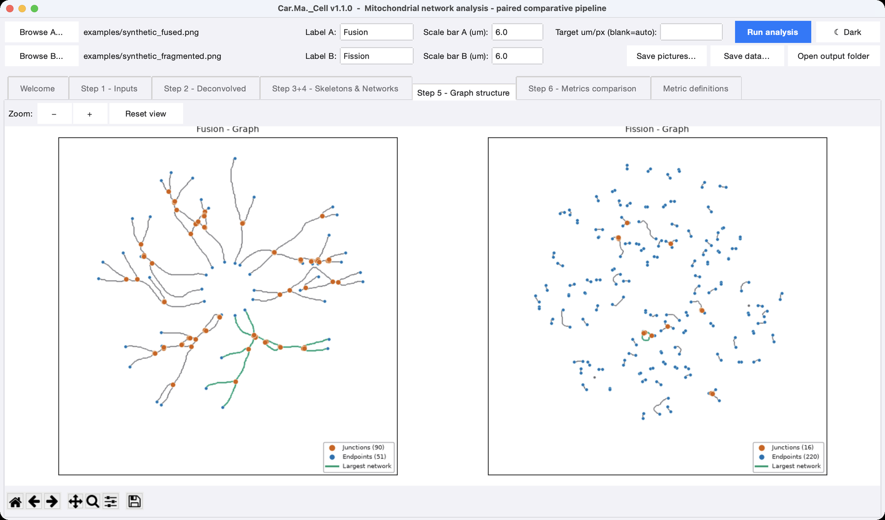

# Car.Ma._Cell

[](https://github.com/colivieri89/Car.Ma._Cell/actions/workflows/tests.yml)
[](https://github.com/colivieri89/Car.Ma._Cell/releases/latest)
[](LICENSE)


Paired analysis of mitochondrial networks in fluorescence micrographs, with a Tkinter graphical interface.

Car.Ma._Cell compares the mitochondrial networks of two cells (by default labelled *Fusion* and *Fission*). Both images are calibrated from their scale bars, brought to a common pixel size and processed with the same parameters; the program extracts the skeleton of each network, turns it into a graph and reports topology, branch lengths, density, branching, connectivity, fragmentation, network complexity, object shape, fractal dimension and node-degree distribution side by side, with figures, CSV and JSON tables and an Excel workbook.

The **[user manual (PDF)](docs/Car.Ma._Cell_User_Manual.pdf)** covers installation, the interface, the method, every metric, the output files, the command line and troubleshooting.



*Step 5 of the synthetic example pair shipped in `examples/`: graph of each cell, with junctions, endpoints and the largest network highlighted.*

## How to use it - two simple steps

Download the source code of the [latest release](https://github.com/colivieri89/Car.Ma._Cell/releases/latest) (`Source code (zip)`) and unzip it into a folder you keep. For each operating system there are **two files**: one to **install** (run once) and one to **start** the program (run every time).

| Operating system | 1) Install once | 2) Start the program |
| --- | --- | --- |
| Microsoft Windows 10 / 11 | **`Install_Windows.bat`** | **`Avvia_Windows.bat`** |
| Apple macOS 11 (Big Sur) or newer | **`Install_Mac.command`** | **`Avvia_Mac.command`** |

> Do **not** double-click `gui.py` or `main.py` directly: on macOS they only
> open as text. Always use the `Avvia_...` file to start the program.

### Step 1 - Install (only the first time)

Double-click the installer for your system. **You don't need to install Python or anything else by hand** - the installer takes care of everything:

1. It checks whether Python 3.9+ is already on your computer.
2. If it isn't, Python 3.12 is downloaded from <https://www.python.org> and installed automatically
   * on Windows: silently and **per-user** (no admin password needed - uses `winget` if available, otherwise the official `python.org` installer);
   * on macOS: with one native **password prompt** (the same `.pkg` you would download by hand).
3. A local virtual environment is created in `.venv/` next to the installer.
4. All scientific dependencies (`numpy`, `scipy`, `scikit-image`, `pandas`, `networkx`, `matplotlib`, `tifffile`, `Pillow`, ...) are downloaded and installed inside that virtual environment.

When it says *"Setup complete"*, the installation is done. You only need to run the installer again if you move the folder to a brand-new computer.

### Step 2 - Start the program (every time)

Double-click the `Avvia_...` file for your system. It opens the Car.Ma._Cell graphical interface with the synthetic example pair already loaded: press **Run analysis** to try it, or choose your own images with **Browse A...** and **Browse B...** and enter the length of each scale bar in micrometres.

Nothing is installed system-wide *by Car.Ma._Cell*: everything sits inside the folder you copied. To "uninstall" simply delete the folder.

### Windows notes

* Works on Windows 10 (build 1809+) and Windows 11. Older Windows still work as long as Python is installed by hand once.
* If you see *"Windows protected your PC"* (SmartScreen) on first launch, click **More info → Run anyway** - this is normal for unsigned `.bat` files distributed by a small lab.

### macOS notes

* Works on Intel and Apple Silicon - the right wheels are picked automatically.
* **Gatekeeper**: the first double-click may show *"... can't be opened because it is from an unidentified developer"*. Right-click (or Control-click) the file → **Open** → **Open** in the dialog. macOS will remember the choice afterwards. To clear the block for the whole folder at once you can also run in Terminal:

  ```bash
  xattr -dr com.apple.quarantine "/path/to/Car.Ma._Cell"
  ```

* If the Finder opens the files as text, mark them as executable. Open **Terminal** in the `Car.Ma._Cell` folder and run:

  ```bash
  chmod +x Install_Mac.command Avvia_Mac.command
  ```

### Linux (developers)

Linux isn't shipped as a click-installer, but the same logic runs from a terminal - just install Python and the Tk bindings first (`sudo apt install python3 python3-venv python3-tk python3-pip` on Debian/Ubuntu), then:

```bash
python3 -m venv .venv
.venv/bin/pip install -r requirements.txt
.venv/bin/python gui.py
```

## What the application does

`Car.Ma._Cell` loads two fluorescence images of mitochondria, each with a scale bar in its bottom-right corner, and runs an identical pipeline on each:

1. **Inputs** - brightest channel, scale-bar detection and calibration, resampling of both images to a common pixel size (the finer of the two, or a value you choose), removal of the scale bar and of any excluded area.
2. **Deconvolution** - Richardson-Lucy with a Gaussian point-spread function (on by default, can be switched off).
3. **Segmentation** - cell envelope, rolling-ball background subtraction, Sato tubeness filter, automatic threshold (Li by default) and morphological cleanup; skeletonisation (Lee 1994).
4. **Network** - 8-connected skeleton graph: branches, junctions, endpoints, networks and individual mitochondria.
5. **Comparison metrics** - topology, lengths, density, branching, connectivity, fragmentation, network complexity index, MNBN, object shape, fractal dimension, degree distribution, ...

Results are written to `main_output/` (PNG figures and CSV/JSON metrics per cell, a comparison table and a side-by-side bar chart); the **Save data…** button writes an Excel workbook. Chapter 6 of the [user manual](docs/Car.Ma._Cell_User_Manual.pdf) describes every step and parameter, Chapter 7 every metric.

## GUI layout

* **Welcome** - splash screen with name, version, authors and licence.
* **Step 1 - Inputs** - choose the two source images, check the previews, exclude areas (debris, neighbouring cells) by dragging rectangles, and set the deconvolution.
* **Step 2 - Deconvolved** - inspect the deconvolved images and set the segmentation.
* **Step 3+4 - Skeletons & Networks** - per-cell skeleton + graph overlays.
* **Step 5 - Graph structure** - a clean node-link graph of each cell (edges = mitochondrial segments, nodes = junctions / endpoints), drawn at the same physical scale as the earlier steps, with the largest connected network highlighted.
* **Step 6 - Metrics comparison** - global-metric table and bar chart; the colour scheme of the bar chart can be changed **after** the run (`color` = Okabe-Ito blue/vermillion, `mono` = grey/black).
* **Metric definitions** - formulae and units for every reported metric.

The whole interface has a light/dark theme (toggle in the toolbar or the **View** menu), and two export buttons (**Save pictures…** and **Save data…**, the latter writing a single Excel workbook).

## Examples

* `examples/synthetic_fused.png` and `examples/synthetic_fragmented.png` - a synthetic pair (scale bars of 6 µm) loaded at start-up, written by `examples/make_synthetic_pair.py`. They are meant only to try the program.
* `examples/example_results/` - the output of a paired analysis of two fluorescence micrographs (labels *Fusion* and *Fission*), as an example of what a run on real cells produces.

## Command line

```bash
python main.py <image A> <scale bar A in um> <image B> <scale bar B in um>
python main.py examples/synthetic_fused.png 6 examples/synthetic_fragmented.png 6
```

Without arguments `python main.py` opens the graphical interface. The package `mitochondrial_network_analysis` holds the building blocks of the pipeline and a single-image command line (`python -m mitochondrial_network_analysis.cli --help`); see Chapter 9 of the manual.

## Files

| File | Purpose |
| --- | --- |
| `Install_Windows.bat` | **Windows** installer (run once). Auto-installs Python if missing, creates the venv and installs all packages. |
| `Avvia_Windows.bat` | **Windows** launcher (run every time). Opens the GUI. |
| `Install_Mac.command` | **macOS** installer (run once). Auto-installs Python if missing (asks for password once), creates the venv and installs all packages. |
| `Avvia_Mac.command` | **macOS** launcher (run every time). Opens the GUI. |
| `gui.py` | Tkinter GUI entry-point. |
| `main.py` | Paired pipeline + CLI. |
| `theme.py` | Light and dark appearance of the GUI. |
| `mitochondrial_network_analysis/` | Reusable analysis library. |
| `requirements.txt` | Python dependencies. |
| `examples/` | Synthetic example pair and example results. |
| `docs/` | User manual (PDF) and its sources. |
| `tests/` | Automated tests (`python -m pytest`). |
| `main_output/` | Auto-created on first run; contains analysis results. |

## Tests

```bash
.venv/bin/pip install pytest
.venv/bin/python -m pytest
```

The tests run the paired pipeline on the synthetic pair and check calibration, output files and metrics. They run automatically on Windows, macOS and Linux at every change of the repository.

## Citation

If you use Car.Ma._Cell, please cite it as described in `CITATION.cff` (GitHub shows it under **Cite this repository**). Every release is archived on Zenodo.

## Licence

Car.Ma._Cell is released under the MIT License: see `LICENSE`. It uses NumPy, SciPy, scikit-image, pandas, NetworkX, Matplotlib, tifffile, imageio, Pillow and openpyxl, each under its own licence.

## Authors

* Dr. Carlo Olivieri
* Dr. Mariarosaria Negri
* Dr. Salvatore Sessa

© 2026 Dr. Carlo Olivieri, Dr. Mariarosaria Negri, Dr. Salvatore Sessa. MIT License.
